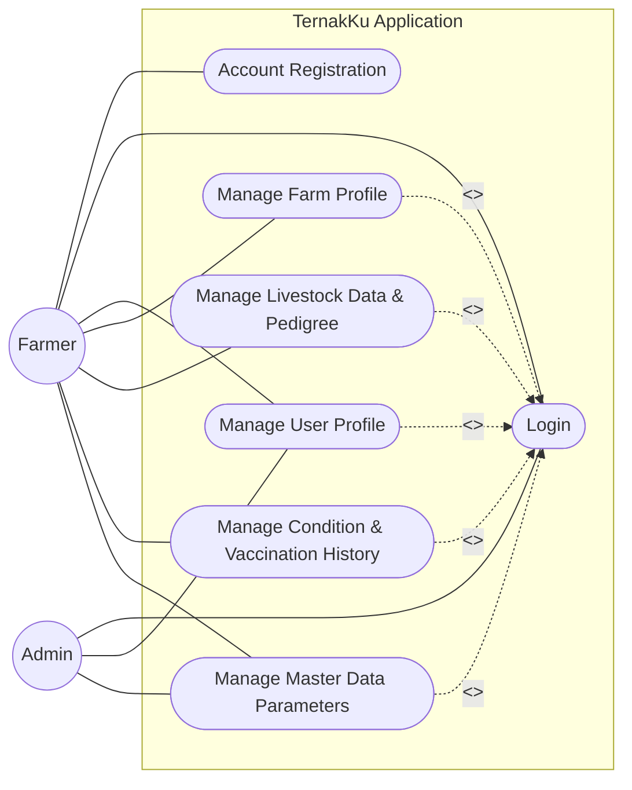
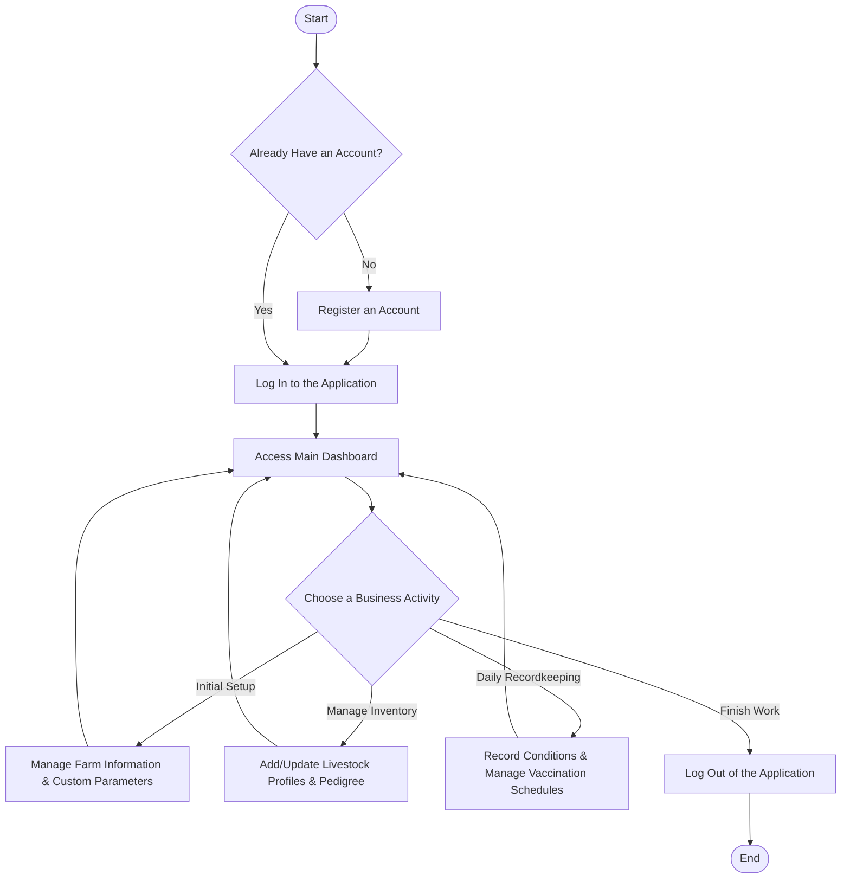

# System Design Documentation

## 📌 Use Case Diagram

### Use Case Descriptions

1. **UC1: Account Registration** — Farmers can register for an account if they do not already have one.

2. **UC2: Login** — Users access the system using their registered credentials. Access and permissions depend on their respective roles, either Farmer or Admin.

3. **UC3: Manage User Profile** — Farmers and Admins can view and update their personal information.

4. **UC4: Manage Farm Profile** — Farmers can complete and update basic information about the location and identity of the farm they manage.

5. **UC5: Manage Livestock Data & Pedigree** — Farmers can view their livestock inventory, add or update individual animal profiles, and record lineage information, including the sire and dam.

6. **UC6: Manage Condition & Vaccination History** — Farmers can maintain daily livestock logs, including births and illnesses, as well as manage vaccination schedules and individual vaccination records.

7. **UC7: Manage Master Data Parameters** — Admins manage global system parameters, including animal types, condition types, and default vaccines. Farmers can also create custom parameters that apply exclusively to their own farms.

---

## ⚙️ Activity Diagram

### Activity Flow Description

1. **Entry Point (Authentication)** — Farmers begin by checking whether they already have an account. If not, they must register before logging in to the application.

2. **Control Center (Dashboard)** — After successfully logging in, farmers are directed to the dashboard, which serves as the central hub for accessing operational activities.

3. **Three Core Business Activities**

   - **Initial Setup:** Performed when setting up the application for the first time. Farmers register their farm information and can define custom parameters, such as specialized condition types or vaccines, when the system's default templates do not meet their needs.

   - **Livestock Inventory Management:** Performed when adding new livestock, updating animal identification details, or linking pedigree information, including the sire and dam, to an animal's record.

   - **Daily Recordkeeping:** Covers routine operational activities. Farmers record current livestock conditions and maintain medical records, including vaccine batch numbers and upcoming vaccination schedules.

4. **Recurring Workflow** — After completing a task, farmers return to the dashboard to continue with another activity or log out when all work is finished.

---

## 🗄️ Entity Relationship Diagram (ERD)

### Entity and Database Design

#### 1. Authentication & Access Control (`users`, `roles`)

- **Registration & Login:** The `users` table stores user credentials through attributes such as `email` and `password`. Account security and verification are supported by `otp_code`, `otp_expiration`, and `is_verified`.
- **Role Separation:** The `role_id` attribute in the user table references the `roles` table, distinguishing the permissions and access privileges of Admins, who manage the system, and Farmers, who use the application for farm operations.

#### 2. Farm Profile Management (`farms`)

- **Single-Farm Ownership:** The `user_id` attribute in the `farms` table uses a `[unique, not null]` constraint to ensure that each user can manage only one farm.
- **Geographic Mapping:** The `latitude` and `longitude` attributes support spatial mapping features using services such as Google Maps or Leaflet.

#### 3. Livestock Inventory & Pedigree (`livestocks`)

- **Flexible Identification:** The `tag_id`, `name`, and `picture` attributes accommodate different livestock identification practices. Small-scale farmers can identify animals by name or physical appearance, while larger farms can use identification numbers such as ear tags.
- **Pedigree Tracking:** Lineage information is implemented through the `father_id` and `mother_id` attributes, which reference other records in the same `livestocks` table to represent the animal's sire and dam.

#### 4. Dynamic Master Data Architecture (`animal_types`, `condition_types`, `vaccines`)

- **Template-Based Design:** When `farm_id` is `null`, the record represents a global default template managed by an Admin. When `farm_id` contains a value, the record represents a custom parameter created by an individual farm.
- **Data Code Integrity:** Composite unique constraints on `(code, farm_id)` allow different farms to create custom parameter codes without conflicting with other farms' codes, while maintaining code uniqueness within each farm.

#### 5. Daily Operations & Medical Records (`condition_histories`, `vaccination_histories`)

- **General Condition History (`condition_histories`):** Functions as a livestock logbook, linking an animal through `livestock_id` to a specific event through `condition_type_id`. Each record includes the actual event date in `record_date` and additional information in `notes`.
- **Vaccination Records (`vaccination_histories`):** Stored separately from general condition records to accommodate vaccination-specific information, such as `batch_number`. Farmers can track the exact vaccine batch administered to an animal, which may help with investigations into disease outbreaks or adverse reactions. The `vaccination_date` attribute supports vaccination scheduling, while `is_vaccinated` indicates whether the vaccination has been administered.