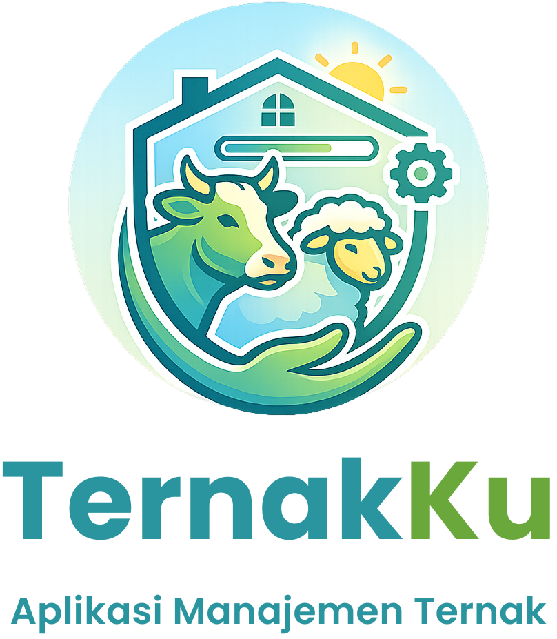
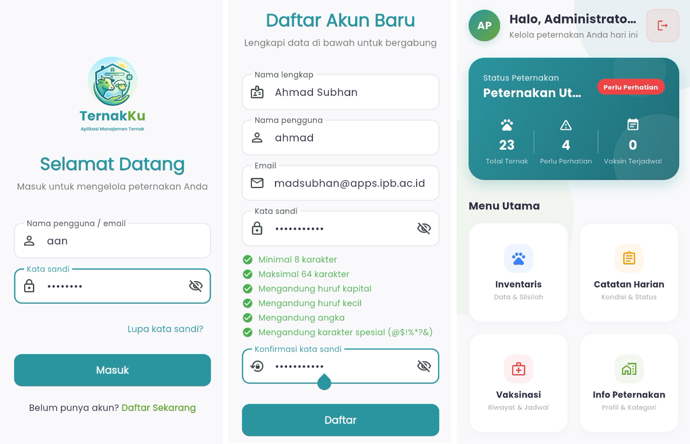
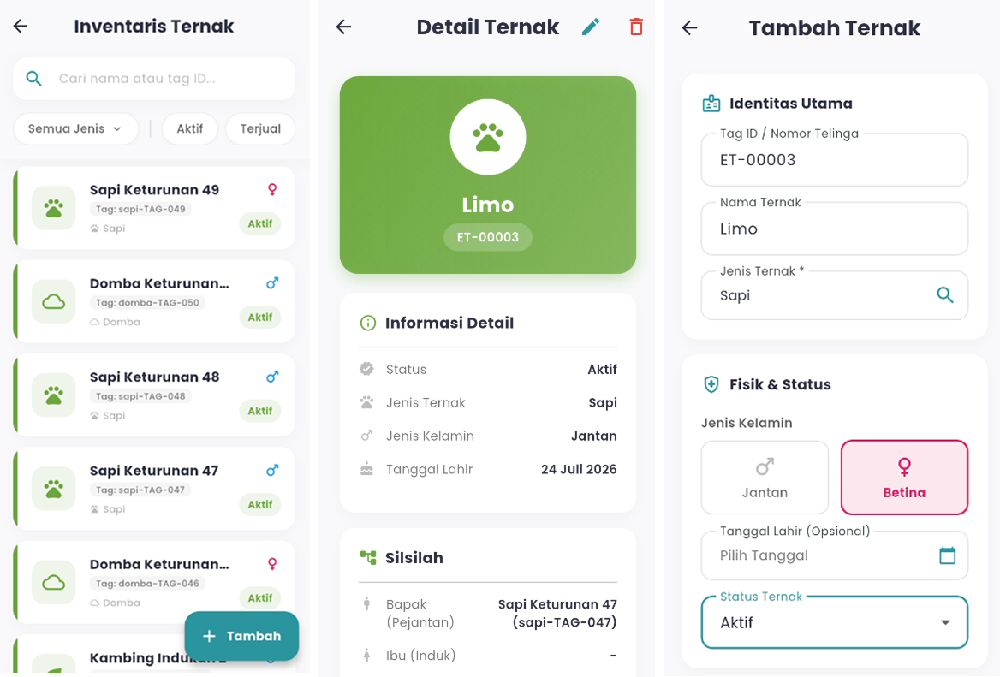
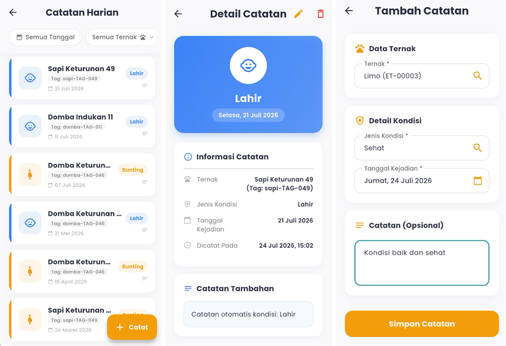
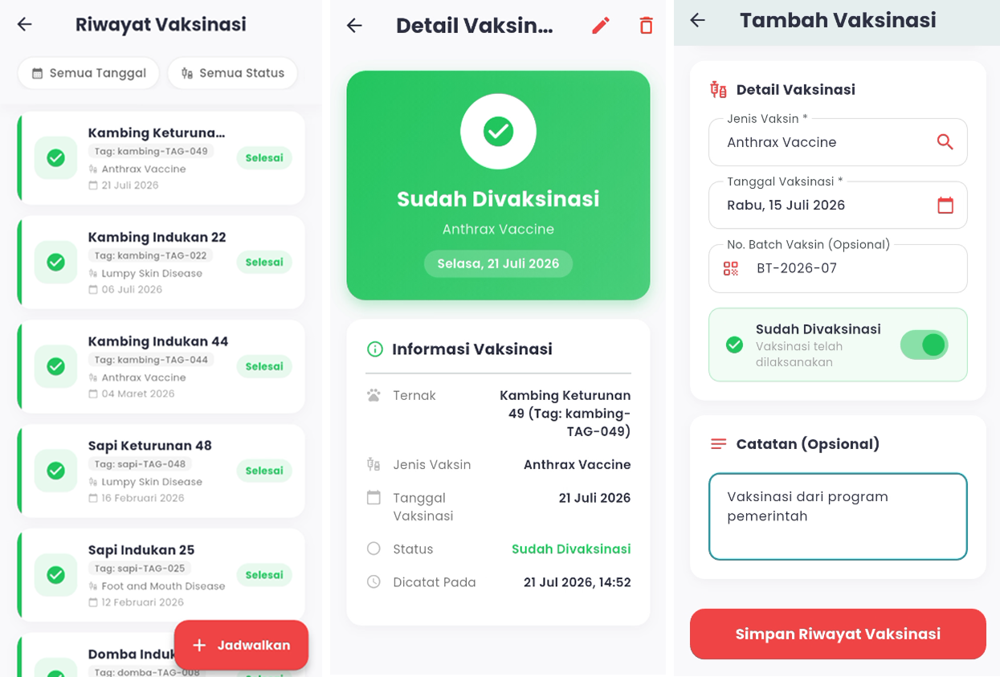

<p align="center">
  
</p>

<p align="center">
  
  &nbsp;&nbsp;
  
  &nbsp;&nbsp;
  
</p>

The mobile application of **TernakKu** is a modern, cross-platform client built with Flutter and Dart. Engineered with clean architecture principles, it serves as the primary touchpoint for farmers to manage livestock inventory, record daily operational events, schedule vaccinations, and track pedigree lineage in real time with an intuitive UI/UX.

## 🛠️ Prerequisites

Make sure the following tools are installed and configured on your development machine before getting started:

- **Flutter SDK** — version `^3.12.2` or later.
- **Dart SDK** — included with Flutter.
- **Android Studio / Xcode** — for running device emulators or physical device builds.
- **Git** — for version control.

## 🚀 Installation & Setup

### 1. Clone the Repository

Clone the repository and navigate to the mobile directory:

```bash
git clone https://github.com/ahmadsubhand/TernakKu-IPB
cd mobile
```

If you have already cloned the unified repository, navigate directly to the `mobile` folder.

### 2. Install Dependencies

Fetch all required package dependencies defined in `pubspec.yaml`:

```bash
flutter pub get
```

### 3. Configure Environment Variables

Create a `.env` file in the root of the `mobile` directory using `.env.example` as a template.

```dotenv
BASE_URL=http://10.0.2.2:3000
```

When testing on an Android Emulator, `10.0.2.2` points directly to your host machine's `localhost`. For physical devices, use your computer's local network IP address (e.g., `[http://192.168.1.](http://192.168.1.)X:3000`).

### 4. Run the Mobile Application

Start the application on a connected device or running emulator:

```bash
flutter run
```

To build a release APK for Android:

```bash
flutter build apk --release
```

## 📁 Project Structure

```text
mobile/
├── android/                  # Android-specific configuration and native files
├── assets/                   # Static assets
├── ios/                      # iOS-specific configuration and native files
├── lib/
│   ├── core/
│   │   ├── constants/        # Shared constants and configuration values
│   │   ├── network/          # HTTP client and network communication setup
│   │   ├── repositories/     # Shared data access and repository implementations
│   │   ├── router/           # Application navigation and route definitions
│   │   ├── services/         # Shared application services
│   │   ├── theme/            # Application themes and styling
│   │   └── validators/       # Reusable input validation logic
│   └── features/
│       ├── auth/
│       ├── condition_history/     # Livestock condition history features
│       │    ├── data/             # Data sources and repositories
│       │    ├── domain/
│       │    │   └── models/       # Data models
│       │    └── presentation/
│       │        ├── providers/    # State management for condition history
│       │        └── screens/      # Screens and UI
│       ├── farm/                  # Farm profile and management features
│       ├── livestock/             # Livestock inventory and pedigree features
│       └── onboarding/            # Initial application setup and onboarding flows
├── linux/                         # Linux desktop platform files
├── macos/                         # macOS desktop platform files
├── test/                          # Unit, widget, and other automated tests
├── web/
│   └── .well-known/
│       └── assetlinks.json   # Android App Links domain verification configuration
├── windows/                  # Windows desktop platform files
├── .env                      # Local environment variables
├── .env.example              # Environment variable template
├── .gitignore                # Git exclusion rules
├── .metadata                 # Flutter project metadata
├── analysis_options.yaml     # Dart static analysis and lint rules
├── pubspec.lock              # Locked dependency versions
├── pubspec.yaml              # Project metadata, dependencies, and assets
└── README.md                 # Mobile application documentation
```

**Notes:**
- Configure environment variables in `.env` using `.env.example` as a reference.
- `.dart_tool/`, `build/`, and `.idea/` are generated or IDE-specific directories and generally should not be committed to version control.
- Manage project dependencies through `pubspec.yaml` and `pubspec.lock`.
- `web/.well-known/assetlinks.json` verifies the association between the application and its website domain for Android App Links using the package name and SHA-256 signing certificate fingerprint.

## 🔐 Security Notes

- Never commit `.env` or expose sensitive configuration values in version control.
- Keep `.env.example` populated with placeholder values only.
- Store authentication tokens securely using `flutter_secure_storage` rather than plain local storage.
- Avoid hardcoding API secrets, credentials, or other sensitive information in the application code.
- Use HTTPS when connecting to the production backend API.

## 📱 Application Screenshots

### 1. 🏠 Home

The Home page is the main screen of the application, providing an overview of farm information and quick access to TernakKu's core features.



### 2. 🐄 Livestock Inventory

The Livestock Inventory menu allows farmers to manage individual livestock records. Users can view their livestock list along with important information about each animal.



### 3. 📝 Daily Logs

The Daily Logs menu enables farmers to record various events and activities occurring on their farms. These records can be used to document livestock conditions and other important events related to farm operations.



### 4. 💉 Vaccination History

The Vaccination History menu allows farmers to record and monitor livestock vaccination records. This feature helps farmers track administered vaccinations and monitor upcoming vaccination schedules.



## 📚 Related Documentation

- [Flutter Documentation](https://docs.flutter.dev/)
- [Riverpod Documentation](https://riverpod.dev/)
- [GoRouter Documentation](https://pub.dev/packages/go_router)
- [Dio Package](https://pub.dev/packages/dio)